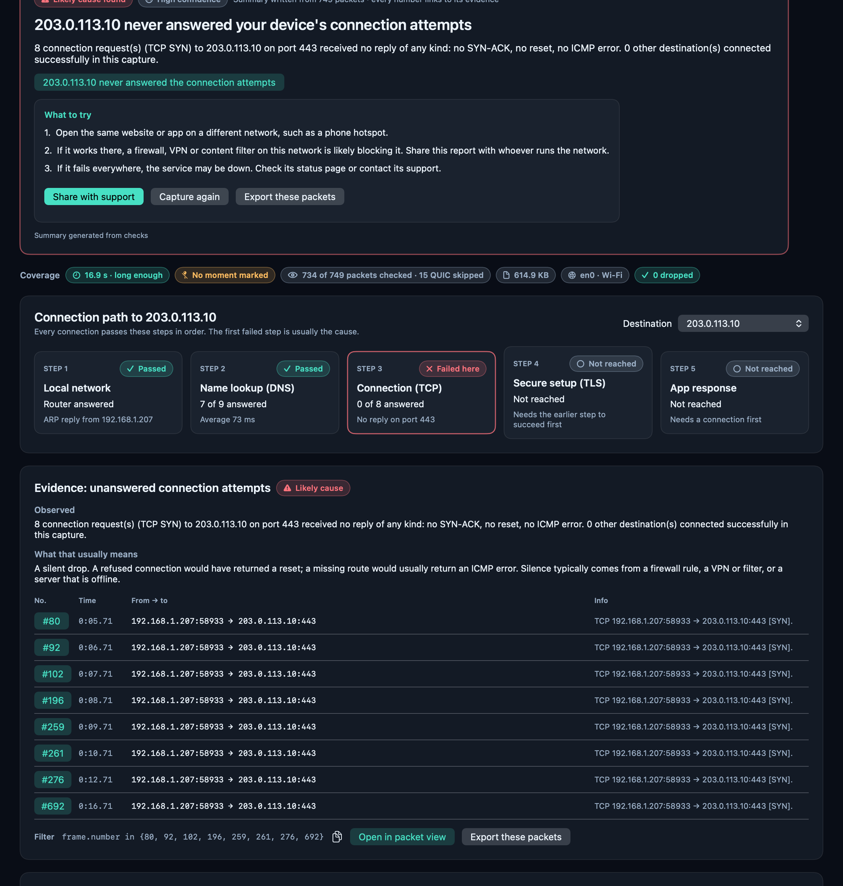
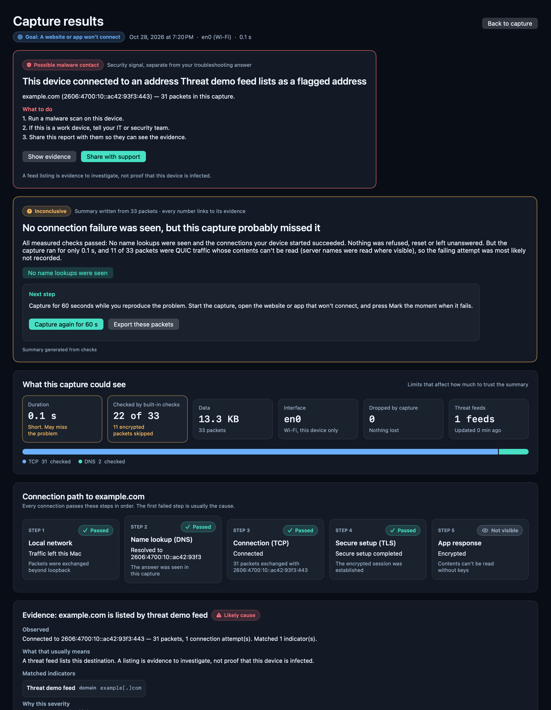
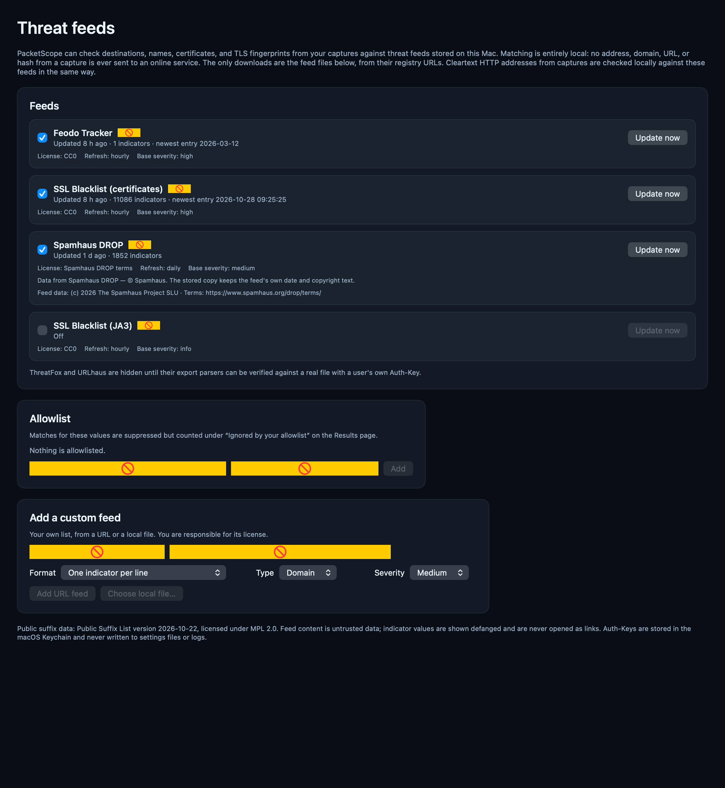
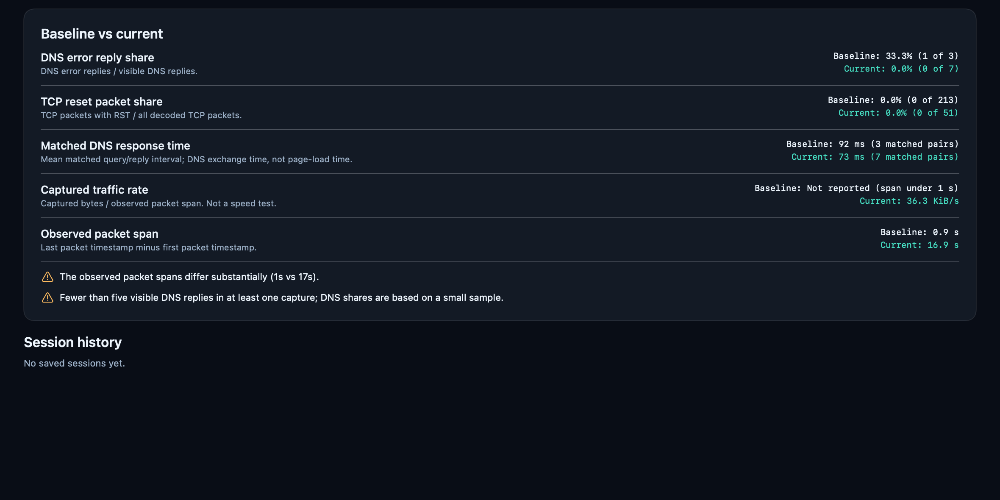

# PacketScope 0.2.0

**When a website won't load, a call freezes, or something is quietly talking
in the background, the honest answer is usually inside the traffic — but the
tools that can read it (Wireshark, tcpdump) assume you already speak packets.**
PacketScope is for everyday Mac users who need an answer they can act on, and
for the administrators they escalate to. You pick the problem in plain words,
capture while it happens, mark the moment it bites, and get back a verdict you
can verify: what was observed, what it most likely means, exactly which packets
prove it, and what to try next — with a separate, clearly-labeled security
signal when a destination appears in a threat feed. Unlike cloud dashboards,
everything (capture, analysis, threat matching, and the optional AI wording)
runs **on your Mac**, and unlike a raw packet tool, every number on the page
links to its evidence. A native Windows version with the same workflow lives
in [`windows/`](windows/).

**Journey:** choose a troubleshooting question → start a real capture →
reproduce the symptom → mark the relevant moment → stop → understand the
measured evidence → try a change and compare → optionally save a support
report.

## Screenshots


*The Results page for the bundled `unanswered-connection.pcap` sample: Step 3
of the connection path is where it broke, with the SYN packets as evidence.*


*A high-severity threat-feed match adds a security card above the (unchanged)
troubleshooting answer.*


*Feeds are local files with visible freshness, counts, and licenses.*


*Before/after comparison with denominators and comparability warnings.*

## Features

1. **Guided captures** — four goals (a website or app won't connect, a slow
   connection, an interrupted call or stream, background activity), an
   optional symptom note, durations from 30 seconds to "Until I stop"
   (15-minute maximum), and "It happened just now" markers (up to 50 per
   session, saved immediately to `context.json`).
2. **Understandable explanations** — bounded, safe PCAP parsing with
   findings for visible DNS error replies, TCP resets, and recognizable
   plaintext (loopback plaintext is informational and kept separate). Every
   finding says what was observed, why it may matter, what to check next,
   what it cannot establish, and links supporting packet numbers.
3. **Before/after comparisons** — DNS error share, TCP reset share, matched
   DNS response time, captured traffic rate, and observed packet span, all
   with denominators and uncertainty. Missing denominators report "No
   observed sample", never 0%. A baseline is an in-memory choice: use the
   current capture, choose from history, clear it, or "Run the same check
   again" to preserve the baseline and start a real new capture.
4. **Process attribution** — process name, PID, and direction taken only
   from macOS PKTAP metadata actually present in the records. Nothing is
   inferred from addresses, ports, or domains. Missing identity goes to an
   explicit **Unknown** group.
5. **Capture Q&A** — an always-available local rules guide (labelled
   "Local evidence guide · rules, no AI") and, on macOS 26+ with Apple
   Intelligence, optional on-device answers via Apple FoundationModels
   (weak-linked; the rules guide works without it). Factual app, marker,
   and comparison answers always come from measured data directly. No
   cloud model, account, or API key is involved anywhere.
6. **Support reports with privacy controls** — a live plain-text preview
   with independent toggles (IP addresses off by default, domain names off
   by default, app/process names on by default, your notes off by default),
   applied to the whole generated text. The raw PCAP export is separate
   and copies the original file unchanged.
7. **Import your own log file** — choose or drag-and-drop a classic PCAP
   capture log from another tool (any filename; the contents are checked)
   on the Capture page. It is copied into a local session with the original
   preserved, needs no administrator authorization, and is analyzed through
   exactly the same pipeline as a live capture, opening the same Results
   page. PCAPNG and plain-text files get a clear explanation instead.
8. **Packet and endpoint inspection** — timeline (Apple Charts, amber
   markers), packet log with search, and endpoints.
9. **Threat intelligence (fully offline)** — destinations, DNS names, SNI,
   HTTP hosts/URLs, certificate hashes, and JA3/JA4 fingerprints from each
   capture are matched on this Mac against downloaded copies of Feodo
   Tracker, Spamhaus DROP, and the SSLBL certificate list (updated in the
   background with strict validation; never any per-address online lookup).
   Matches are grouped as one security finding per destination under a
   security card that sits beside — never inside — your troubleshooting
   verdict, with severity reasons, an allowlist, custom feeds, and
   Keychain-stored keys for the optional keyed feeds. Nothing about a
   capture is ever sent to a feed provider.

All analysis, session storage, and optional inference stay on the Mac.
There is no telemetry, external reputation lookup, reverse-DNS lookup, or
cloud inference.

**Try it in two minutes, no admin rights needed:** the `samples/` folder
(included in both release ZIPs) has three small captures recorded against
reserved test addresses — `unanswered-connection.pcap` (a destination that
never replies), `name-not-found.pcap` (a name that does not exist), and
`threat-demo.pcap` plus `threat-demo-feed.txt`. Import one on the Capture
page and PacketScope walks you to its Results page. For the threat demo,
first add the feed file under Threat feeds → Add a custom feed (Type:
Domain, Format: one indicator per line), then import `threat-demo.pcap`.

## Download

**macOS ( Apple Silicon and Intel ):** download `PacketScope-macOS.zip`
from the macOS release, unzip it, and open
`PacketScope.app` inside the "PacketScope Demo" folder. Requires macOS 13.0
or later. The build is ad hoc signed (not notarized). On first launch macOS will
refuse to open it: open the app once, then go to **System Settings →
Privacy & Security** and click **Open Anyway**, then open it again.
Capturing asks for administrator
approval via the standard macOS prompt; opening existing capture files
needs no approval.

**Windows:** a Windows version lives in [`windows/`](windows/) (native
C#/.NET WinForms; live capture through Npcap, fully local threat-intel
matching). Download `PacketScope-Windows.zip` from the
[windows-v0.1.0 release](../../releases/tag/windows-v0.1.0), unzip, install
[Npcap](https://npcap.com) for live capture, and run `PacketScope.exe`.


## Building from source

This repository contains two independent native implementations of
PacketScope: the macOS app at the project root and the Windows app under
[`windows/`](windows/). Clone the repository first:

```sh
git clone https://github.com/CyberfunkChill12/PacketScope.git
cd PacketScope
```

### macOS app

You need a Mac running a version of macOS supported by the current Xcode
command-line tools. The Mac app is built directly with `clang` and `swiftc`
in Swift 5 language mode; there is no Xcode project and no third-party
package to install.

```sh
bash scripts/build.sh
open dist/PacketScope.app
```

This produces a universal `arm64` + `x86_64` build in
`dist/PacketScope.app`. Use the test and packaging commands in the
**Build, test, and package** section below when you need the full verified
build or the distributable macOS ZIP.

### Windows app

On Windows 10 or 11 (64-bit), install the [.NET 8 SDK](https://dotnet.microsoft.com/download/dotnet/8.0),
then build a self-contained executable:

```powershell
cd windows\PacketScope.Windows
dotnet publish -c Release -r win-x64 --self-contained true
```

The published `PacketScope.exe` is written to
`bin\Release\net8.0-windows\win-x64\publish\`. Npcap is a runtime
requirement for live capture only; it is not needed to compile the app or
to import and analyze existing capture files.

Run the Windows analyzer, results-builder, threat-intel, and AI-summary
validation tests with:

```powershell
cd ..\PacketScope.Tests
dotnet run -c Release
```

The Windows project can be compiled from macOS or Linux because Windows
targeting is enabled in the project file, but the GUI and Npcap capture can
only run on Windows. See [`windows/README-WINDOWS.md`](windows/README-WINDOWS.md)
for the Windows feature scope and limitations.

## Requirements

**macOS requirements:** 
- Runtime: macOS 13.0 or later (universal `arm64` + `x86_64`).
- Build: Xcode command-line tools, `clang`, and `swiftc` in Swift 5 language
  mode. No Xcode project, no third-party packages, nothing to install from
  Homebrew. The bundled C helper links the system `libpcap`.
- Capturing asks for administrator approval via the native macOS prompt
  (the GUI never runs as root, and PocketScope never sees your password).
  Opening existing PCAP files needs no approval.

**Windows requirements:** 
- Windows 10/11 64-bit;
- Npcap for live capture
(administrator rights may be needed if an adapter won't open);
- no .NET install needed (self-contained);
- optional Ollama for the local AI summary.
  
Importing and analyzing capture files works without Npcap. See
[`windows/README-WINDOWS.md`](windows/README-WINDOWS.md) for its feature
scope and differences from the macOS app (optional local-model AI summary,
validated with template fallback; QUIC names not yet extracted; process
attribution is endpoint-matched and approximate).

## Build, test, and package

From the project root:

```sh
bash scripts/build.sh    # → dist/PacketScope.app (universal, ad hoc signed)
bash scripts/test.sh     # runs the automated test suites (synthetic traffic only)
bash scripts/package.sh  # → dist/PacketScope-macOS.zip
```

`package.sh` produces a ZIP which, when extracted, contains:

```text
PacketScope Demo/
  PacketScope.app
  START HERE.txt
```

Signing: the helper and app are **ad hoc signed** for the development demo.
`codesign --verify --deep --strict` is verified in `build.sh` and again on the
extracted ZIP in `package.sh`, along with `lipo` checks that both binaries
contain `arm64` and `x86_64` and a check that `FoundationModels` is
weak-linked. No Developer ID signing or notarization is claimed or performed.

## Layout

```text
PacketScope/
  Sources/
    PacketScopeApp.swift   # app lifecycle, menus, quit cleanup
    AppModel.swift         # main-actor state, capture/import/history/export
    Analyzer.swift         # PCAP parsing and full-file measured facts
    Features.swift         # goals/context, explanations, comparisons, redaction
    CaptureAssistant.swift # rules guide, optional on-device model, output checks
    ContentView.swift      # theme, navigation, overview/packet/endpoint UI
    FeatureViews.swift     # guided setup, timeline/apps/compare/Q&A/history/support
  Helper/capture.c         # packetscope-capture (libpcap, PKTAP, privilege drop)
  Resources/Info.plist
  Tests/                   # 116 automated macOS test cases + live_traffic.py (dev only)
  QUICKSTART.txt
scripts/  build.sh  package.sh  test.sh  make_icon.swift
```

Sessions live under `~/Library/Application Support/PacketScope/Sessions/<timestamp_UUID>/`
containing `traffic.pcap`, `report.json`, `report.txt`, `context.json`, and
live-session `status.json` / `capture.log` / `stop.request` as applicable.

## Capture helper contract

```text
packetscope-capture --interfaces
packetscope-capture --interface INTERFACE --directory SESSION_DIRECTORY
  --uid UID --gid GID --duration SECONDS --max-bytes BYTES
  --watch-pid APP_PID --attribution 1
```

The helper captures passively (non-promiscuous, no probes or injection),
prefers PKTAP for process attribution scoped to the selected interface, and
falls back to an ordinary capture (with attribution off and the limitation
disclosed) when PKTAP is unavailable. It opens BPF with privileges, then
uses `initgroups`/`setgid`/`setuid` to become the invoking user before
creating any output files, enforces a 100 MiB capture file cap and the
requested duration, polls for a validated `stop.request`, publishes
`status.json` atomically about once a second, and reports kernel drops from
`pcap_stats`. This is a demo architecture: there is no persistent privileged
service, no setuid binary, and no permanent BPF permission change.

## Results page

The Results tab renders only from a structured `CaptureResults` object
(`PacketScope/Sources/Results.swift`): a code-decided verdict (template
summary always available; optional on-device AI may only reword it after
strict number/name/citation validation), quantified coverage with a traffic
mix bar, a five-step connection path per destination, findings with evidence
packet tables and copyable display filters, per-lookup DNS timings (answered,
average, p95, slowest, resolver), the eight built-in checks, a destinations
table, and a timeline with marked moments. Destination names come from DNS
answers or TLS ClientHello SNI, never from payload contents, and credentials
or payload data are never sent to the summarizer.

## Verification status (October 28, 2026 run)

- All 116 automated macOS test cases pass (`bash scripts/test.sh`), and the
  Windows harness passes 34/34 (`windows/PacketScope.Tests`): parser bounds,
  both byte orders and timestamp resolutions, supported link types,
  full-file statistics beyond the 2,000 displayed rows, DNS matching with
  retry/duplicate/mDNS exclusions, PKTAP v1/v2 attribution, loopback vs
  non-loopback plaintext, helper argument and session-directory validation,
  context compatibility, explanations, comparisons, redaction, and the
  assistant's evidence/validation behavior.
- `bash scripts/build.sh` and `bash scripts/package.sh` complete here on
  macOS 27.0 (Swift 6.4, Swift 5 language mode): both binaries are verified
  universal (`arm64` + `x86_64`), the app is ad hoc signed with
  `codesign --verify --deep --strict` passing on the extracted ZIP, and
  `FoundationModels` is verified weak-linked.
- A controlled live capture on `lo0` with synthetic localhost HTTP/ping
  traffic, a saved marker, a user-initiated stop, and post-stop analysis
  was exercised against the bundled helper with the native administrator
  prompt (see the completion report delivered with this build for
  measured numbers from that run).
- A real on-device model answer was exercised when the current machine's
  Apple Intelligence model reported available; the rules-only path is
  covered by the automated tests and is always available.
- Threat-intel fixtures all behave as specified against the synthetic test
  feed, and the fixed evidence filters were checked with Wireshark's tshark:
  the match count for each frame-list filter and for
  `dns.flags.response == 0 && !dns.response_in` equals the count the app
  shows, including on the bundled sample captures. JA3/JA4 output is
  byte-identical to tshark's on the same ClientHellos (GREASE-safe).
- The sample captures in `samples/` were recorded live against reserved
  test addresses (an unanswered `curl` to 203.0.113.10, an NXDOMAIN lookup,
  and a real `example.com` connection for the threat demo).

## Not in this version

No whole-LAN visibility claim, packet decryption, TLS interception, PCAPNG
support, full TCP-stream/IP-fragment reassembly, DNS reassembly across TCP
segments, firewall blocking, intrusion prevention, or malware verdicts.
There are **no online reputation lookups** and no cloud chatbot: threat
matching is done entirely offline against downloaded feed copies (see
feature 9), and no address, domain, or hash from a capture is ever sent to
a lookup service. Also out of scope: autonomous remediation, automatic
sharing, and any background monitoring service.
